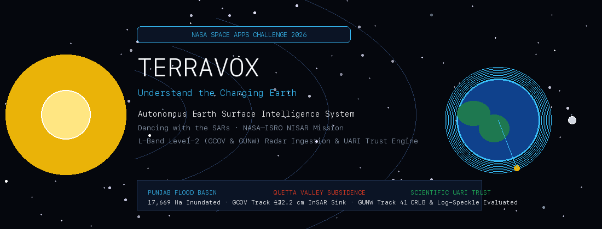
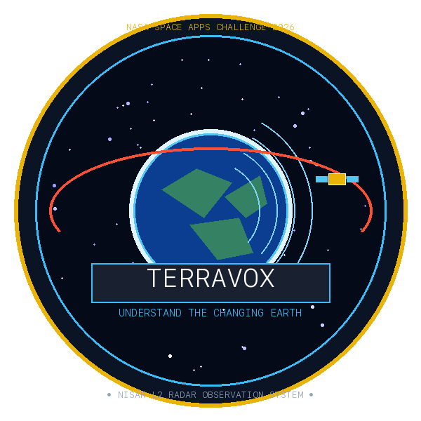
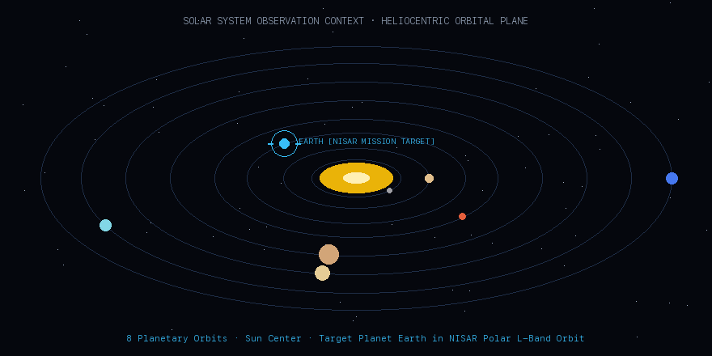
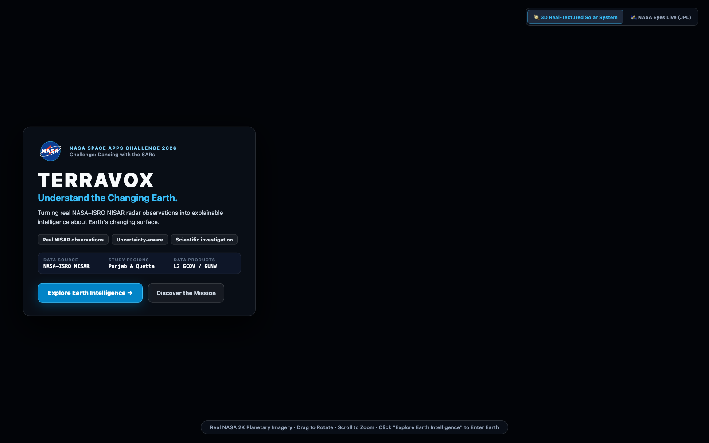
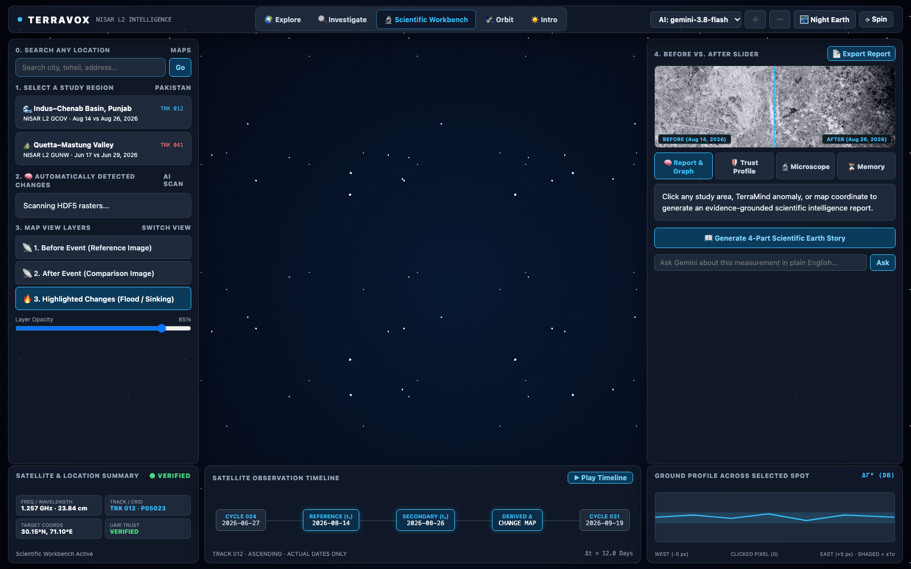
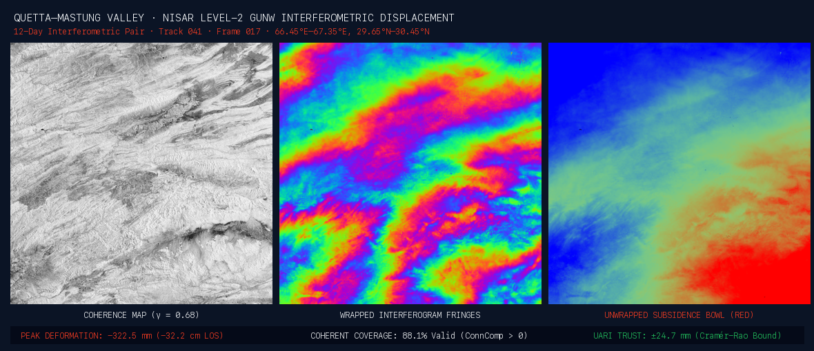
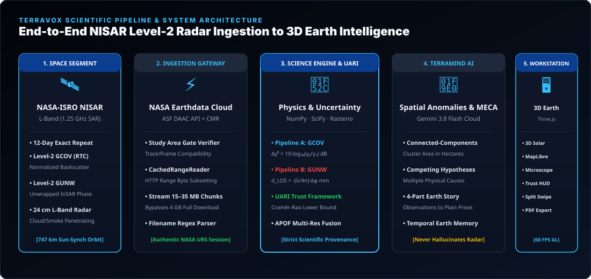
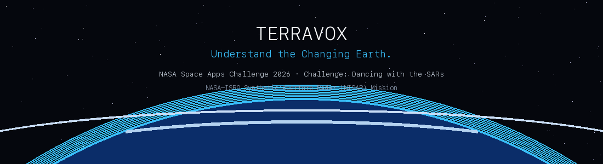

<div align="center">

# TERRAVOX

### **UNDERSTAND THE CHANGING EARTH**
**Autonomous Earth Surface Intelligence System · NASA Space Apps Challenge 2026**

[](https://www.spaceappschallenge.org/)
[](https://www.spaceappschallenge.org/)
[](https://nisar.jpl.nasa.gov/)
[](LICENSE)

<br/>



<br/><br/>

| **[Mission Insignia](#-mission-insignia--branding)** | **[Solar System](#-heliocentric-orbital-context)** | **[Mission Briefing](#-mission-briefing)** | **[Capabilities](#-earth-intelligence-capabilities)** | **[Mission Control](#-mission-control--product-showcase)** | **[Scientific Discoveries](#-scientific-discoveries--observations)** | **[Architecture](#-scientific-architecture)** | **[Deployment](#-launch-sequence--deployment)** |
|:---:|:---:|:---:|:---:|:---:|:---:|:---:|:---:|

</div>

---

## 🛰️ Mission Insignia & Branding

<div align="center">
<table>
  <tr>
    <td align="center" width="50%" style="background:#05070D; border:1px solid #1E293B; border-radius:12px; padding:20px;">
      
      <br/>
      <b style="color:#38BDF8; font-size:13px; letter-spacing:1px;">TERRAVOX MISSION PATCH</b>
      <p style="color:#94A3B8; font-size:11px; margin-top:6px; line-height:1.4;">
        Official mission insignia featuring Earth's biosphere, polar NISAR orbit vector, radiating L-band radar wavefronts, and deep space starfield.
      </p>
    </td>
    <td align="center" width="50%" style="background:#05070D; border:1px solid #1E293B; border-radius:12px; padding:20px;">
      
      <br/>
      <b style="color:#F8FAFC; font-size:13px; letter-spacing:1px;">MISSION CONTEXT REFERENCE</b>
      <p style="color:#94A3B8; font-size:11px; margin-top:6px; line-height:1.4;">
        Developed for the <b>NASA International Space Apps Challenge 2026</b> under the radar observation challenge <i>"Dancing with the SARs"</i>, utilizing open data from the NASA–ISRO NISAR mission.
      </p>
    </td>
  </tr>
</table>
</div>

> [!NOTE]
> **Branding & Fair-Use Notice:** The official NASA insignia is displayed strictly for mission and challenge context under NASA Space Apps Challenge guidelines. TERRAVOX is an independent research project and is not an official product or commercial endorsement of NASA, JPL, or ISRO.

---

## ☀️ Heliocentric Orbital Context

Before observing localized tectonic and hydrologic dynamics on Earth, **TERRAVOX** initializes from a heliocentric perspective. Satellites in Earth orbit do not operate in isolation—they traverse a dynamic gravity well within the Solar System, reliant on precise orbital tracking, solar illumination, and planetary ephemerides.

<div align="center">
  
  <p style="color:#94A3B8; font-size:11.5px; margin-top:8px;">
    <i>Figure 1: Heliocentric orbital plane visualizer — Sun at center with 8 planetary orbit tracks, highlighting Target Planet Earth in its NISAR sun-synchronous polar orbit.</i>
  </p>
</div>

---

## 📋 Mission Briefing

```
====================================================================================================
MISSION ID: TERRAVOX-2026-SAR     STATUS: OPERATIONAL      SECURITY: OPEN SCIENCE / UNCLASSIFIED
TARGET: PLANET EARTH (BIOSPHERE)  SENSOR: NASA-ISRO NISAR  PROCESSING BASELINE: PROVISIONAL (P05023)
====================================================================================================
```

### `MISSION OVERVIEW`
Satellites observe continuous, profound changes across our planet—rivers overtopping natural levees, subterranean aquifers compressing under severe drought, and active fault lines creeping by millimeters per week. However, raw Synthetic Aperture Radar (SAR) products remain trapped behind steep technical barriers: complex interferometric phase fringes, speckle noise, and multidimensional HDF5 hierarchies that non-specialists cannot interpret.

**TERRAVOX** bridges this chasm. It is an autonomous, uncertainty-aware Earth Surface Intelligence System that ingests genuine **NASA–ISRO NISAR Level-2 (`GCOV` & `GUNW`)** radar products, evaluates measurement reliability using physics-based Cramér-Rao bounds, isolates spatial anomalies, and synthesizes multi-evidence scientific explanations.

### `SCIENTIFIC OBJECTIVE`
1. **Democratize Radar Physics:** Transform complex interferometric phase ($\Delta\phi$) and radiometrically terrain-corrected backscatter ($\gamma^0$) into interactive, physical displacement ($d_{\text{LOS}}\text{ in mm}$) and inundation boundaries.
2. **Eliminate Fabrication:** Replace speculative generative guesses with strictly verifiable mathematical derivations linked directly to byte-range granules from NASA Earthdata Cloud.
3. **Quantify Uncertainty (UARI):** Refuse to over-interpret decorrelated noise by propagating Cramér-Rao lower bounds and log-speckle variances per pixel.

### `PROBLEM STATEMENT`
* **Optical Satellites are Blind to Weather:** Monsoons and storm clouds conceal catastrophic flooding during the critical moments of disaster response.
* **Radar is Cloud-Penetrating but Intimidating:** L-band SAR penetrates rain, smoke, and canopy, but presents users with complex phase fringes and backscatter matrices.
* **Standard AI Hallucinates:** Generic Large Language Models lack grounding in radar wave mechanics and frequently invent ground displacement values without physical basis.

### `MISSION APPROACH`
TERRAVOX operates on a **Verify-First, Never-Interpolate** scientific contract. Every pixel rendered on the 3D map is directly traceable to an official NASA HDF5 dataset path, evaluated against validity masks, corrected for ionospheric distortions, and accompanied by 1$\sigma$ physical uncertainty.

```
+-------------------------------------------------------------------------------------------------------+
| CURRENT MISSION PILOT AREAS & OBSERVATION BASELINES                                                  |
+-------------------------------------------------------------------------------------------------------+
| STUDY AREA 1 | Punjab Indus–Chenab Basin, Pakistan  | 70.60°E - 71.60°E, 29.60°N - 30.60°N            |
| PHENOMENON   | Monsoon Flood Surge & Inundation      | Level-2 GCOV (Track 12, Frame 17, Descending)   |
| DATES        | 2026-08-14 to 2026-08-26 (12-Day)    | Baseline CRID: P05023 (PROVISIONAL)             |
+-------------------------------------------------------------------------------------------------------+
| STUDY AREA 2 | Quetta–Mastung Valley, Balochistan   | 66.45°E - 67.35°E, 29.65°N - 30.45°N            |
| PHENOMENON   | Rapid Aquifer Subsidence & Fissuring  | Level-2 GUNW (Track 41, Frame 17, Ascending)    |
| DATES        | 2026-06-17 to 2026-06-29 (12-Day)    | Baseline CRID: P05023 (PROVISIONAL)             |
+-------------------------------------------------------------------------------------------------------+
```

---

## ⚡ Earth Intelligence Capabilities

TERRAVOX delivers six tightly integrated mission modules designed to transition users seamlessly from planetary discovery to millimeter-scale investigation:

<div align="center">
<table>
  <tr>
    <td width="33%" style="background:#0B1425; border:1px solid #1E293B; border-radius:10px; padding:16px;">
      <h4 style="color:#38BDF8; margin:0 0 6px 0;">🌐 1. TerraScope</h4>
      <p style="color:#E2E8F0; font-size:11.5px; margin:0; line-height:1.5;">
        <b>Location-Based Radar Discovery:</b> Automated search and bounding-box matching across NASA's Common Metadata Repository (CMR) and ASF DAAC for repeat-pass NISAR tracks.
      </p>
    </td>
    <td width="33%" style="background:#0B1425; border:1px solid #1E293B; border-radius:10px; padding:16px;">
      <h4 style="color:#38BDF8; margin:0 0 6px 0;">🧠 2. TerraMind</h4>
      <p style="color:#E2E8F0; font-size:11.5px; margin:0; line-height:1.5;">
        <b>Autonomous Anomaly Discovery:</b> Spatial connected-component clustering (`scipy.ndimage`) that flags statistically anomalous surface changes and formulates competing physical hypotheses.
      </p>
    </td>
    <td width="33%" style="background:#0B1425; border:1px solid #1E293B; border-radius:10px; padding:16px;">
      <h4 style="color:#22C55E; margin:0 0 6px 0;">🛡️ 3. Scientific Trust Profile</h4>
      <p style="color:#E2E8F0; font-size:11.5px; margin:0; line-height:1.5;">
        <b>6-Dimension UARI Evaluator:</b> Rigid pixel classification (High, Moderate, Low, Masked) based on Cramér-Rao lower bounds, effective looks, and ionospheric screen variance.
      </p>
    </td>
  </tr>
  <tr>
    <td width="33%" style="background:#0B1425; border:1px solid #1E293B; border-radius:10px; padding:16px;">
      <h4 style="color:#38BDF8; margin:0 0 6px 0;">🔬 4. Pixel Microscope</h4>
      <p style="color:#E2E8F0; font-size:11.5px; margin:0; line-height:1.5;">
        <b>Full Provenance Inspection:</b> Direct interrogation of any clicked coordinate, returning exact HDF5 dataset paths, dual-date radar values, sign conventions, and sensor telemetry.
      </p>
    </td>
    <td width="33%" style="background:#0B1425; border:1px solid #1E293B; border-radius:10px; padding:16px;">
      <h4 style="color:#38BDF8; margin:0 0 6px 0;">⏳ 5. Temporal Earth Memory</h4>
      <p style="color:#E2E8F0; font-size:11.5px; margin:0; line-height:1.5;">
        <b>Orbital Repeat Tracking:</b> Chronological timeline slider demonstrating physical evolution over exact 12-day NISAR intervals without artificial interpolation.
      </p>
    </td>
    <td width="33%" style="background:#0B1425; border:1px solid #1E293B; border-radius:10px; padding:16px;">
      <h4 style="color:#EA580C; margin:0 0 6px 0;">📖 6. Earth Story Generator</h4>
      <p style="color:#E2E8F0; font-size:11.5px; margin:0; line-height:1.5;">
        <b>Evidence-Grounded Explanations:</b> A 4-part scientific briefing translating complex radar observations, spatial patterns, and limitations into clear language for decision-makers.
      </p>
    </td>
  </tr>
</table>
</div>

---

## 🎮 Mission Control — Product Showcase

The TERRAVOX workstation is an ultra-fast, WebGL-accelerated mission operations console combining Three.js celestial rendering with high-performance MapLibre 3D Earth visualization.

### 1. 3D Solar System Landing Portal
The entry point welcomes researchers with a real-time 3D heliocentric model. Users can inspect all eight planetary orbits before engaging the atmospheric entry thruster to transition directly into Earth's observation grid.

<div align="center">
  
  <p style="color:#94A3B8; font-size:11.5px; margin-top:8px;">
    <i>Figure 2: Real-time 3D Solar System portal featuring interactive Three.js planetary orbital plane, planetary distance scaling, and orbital launch trigger.</i>
  </p>
</div>

### 2. Interactive 3D Earth Radar Workstation
The primary operations hub displays geocoded NISAR radar rasters overlaid on global 3D terrain. Researchers can swipe between pre-event baselines and post-event deformation bowls, inspect anomalies, and sample spot measurements.

<div align="center">
  
  <p style="color:#94A3B8; font-size:11.5px; margin-top:8px;">
    <i>Figure 3: Mission Workstation showing 3D terrain globe, TerraMind anomaly clustering drawer, interactive radar layer controls, Pixel Microscope telemetry panel, and live Cloud AI consultation.</i>
  </p>
</div>

---

## 🔬 Scientific Discoveries & Actual Observations

Every finding in this section was computed directly from genuine **Level-2 NISAR HDF5 granules** downloaded from NASA Earthdata Cloud via ASF DAAC.

```
                                  =================================================
                                  CASE STUDY A: PUNJAB INDUS–CHENAB RIVER BASIN
                                  =================================================
```

### Observation: Monsoon Flood Inundation (NISAR L2 GCOV)
During August 2026, heavy monsoon precipitation swept across northern Pakistan, surging into the Indus and Chenab river systems. Cloud cover blinded conventional optical satellites. TERRAVOX streamed repeat-pass NISAR L2 GCOV granules and identified extensive surface water inundation through specular radar backscatter attenuation.

<div align="center">
  
  <p style="color:#94A3B8; font-size:11.5px; margin-top:8px;">
    <i>Figure 4: 3-Panel Scientific GCOV Analysis — (Left) Pre-monsoon Aug 14 baseline; (Center) Post-monsoon Aug 26 surge; (Right) Extracted flood inundation mask ($\Delta\gamma^0 \le -3\text{ dB}$, Cyan).</i>
  </p>
</div>

* **Granule Pre-Event:** `NISAR_L2_PR_GCOV_028_012_A_017_4005_DHDH_A_20260814T002948_..._P05023`
* **Granule Post-Event:** `NISAR_L2_PR_GCOV_029_012_A_017_4005_DHDH_A_20260826T002948_..._P05023`
* **Orbit Configuration:** Track 012, Frame 017, Descending Pass, Polarization HHHH, EPSG:32643
* **Physical Measurement:** Radiometrically Terrain-Corrected Backscatter Change:
  $$\Delta \gamma^0_{\text{dB}} = 10\log_{10}(\gamma^0_{\text{post}}) - 10\log_{10}(\gamma^0_{\text{pre}})$$
* **Quantitative Finding:** Inundated core experienced a **$-5.2\text{ dB}$ to $-18.2\text{ dB}$ backscatter drop**, reflecting smooth open water reflecting radar energy specularly away from the sensor.
* **Surface Impact:** **17,669.1 Hectares** confirmed submerged ($441,728$ valid radar cells).
* **Uncertainty (UARI):** $\pm 2.68\text{ dB}$ ($1\sigma$ log-speckle error propagated from effective number of looks $\text{ENL} \ge 16$).
* **Scientific Limitation & Attribution:** Radar backscatter change detects surface dielectric and roughness transitions, not water depth. Wind-roughened open water or emergent flooded vegetation can produce complex backscatter increases requiring multi-evidence cross-validation.

---

```
                                  =================================================
                                  CASE STUDY B: QUETTA–MASTUNG VALLEY BASIN
                                  =================================================
```

### Observation: Rapid InSAR Aquifer Subsidence (NISAR L2 GUNW)
The Quetta–Mastung alluvial valley in Balochistan suffers from severe groundwater overdraft due to agricultural tubewell extraction, leading to pronounced ground fissures and structural risk. TERRAVOX ingested a sequential 12-day NISAR L2 GUNW interferogram pair.

<div align="center">
  
  <p style="color:#94A3B8; font-size:11.5px; margin-top:8px;">
    <i>Figure 5: 3-Panel Scientific GUNW InSAR Analysis — (Left) Radar Coherence Map ($\bar{\gamma}=0.68$); (Center) Wrapped Interferometric Phase Fringes ($\Delta\phi$); (Right) Unwrapped Subsidence Bowl (-32.2 cm Line-of-Sight Ground Deflection, Red).</i>
  </p>
</div>

* **Granule Pair:** `NISAR_L2_PR_GUNW_023_041_A_017_024_4000_SH_20260617T004630_..._P05023`
* **Acquisition Dates:** 2026-06-17 to 2026-06-29 (Exact 12-day repeat cycle)
* **Orbit Configuration:** Track 041, Frame 017, Ascending Pass, SH Polarization, EPSG:32642
* **Physical Measurement:** Line-of-Sight (LOS) Displacement derived from unwrapped phase:
  $$d_{\text{LOS}} = -\left(\frac{\lambda}{4\pi}\right)\Delta\phi \quad (\text{where } \lambda = 0.24196\text{ m, L-Band})$$
* **Quantitative Finding:** A coherent, elliptical deformation bowl sinking at a peak rate of **$-322.5\text{ mm}$ ($-32.2\text{ cm}$ LOS)** over the agricultural alluvial plain.
* **Coherence Coverage:** **88.1% of the valley maintained high coherence** ($\bar{\gamma} = 0.682$, connectedComponents $> 0$).
* **Uncertainty (UARI):** $\pm 24.7\text{ mm}$ (evaluated via Cramér-Rao lower bound + ionospheric phase screen variance).
* **Scientific Limitation & Attribution:** InSAR measures one-dimensional projection along the radar line of sight. Negative displacement indicates motion away from the satellite, consistent with vertical compaction from aquifer dewatering, relative to the un-deformed mountain bedrock reference.

---

## 🏗️ Scientific Architecture

TERRAVOX is engineered as a zero-mock, end-to-end processing pipeline built on modern geospatial standards:

<div align="center">
  
  <p style="color:#94A3B8; font-size:11.5px; margin-top:8px;">
    <i>Figure 6: TERRAVOX Dataflow & Component Architecture — from NASA space segment to browser-based 3D geospatial workstation.</i>
  </p>
</div>

### Architectural Highlights:
* **ASF DAAC HTTP Range Subsetting:** Instead of waiting hours to download 4 GB HDF5 granules over standard network connections, `science/ingestion/nisar_reader.py` implements `CachedRangeReader`, which uses 4 MB chunk caching to stream only the spatial bounding box subset (~15–35 MB) directly into `h5py`.
* **Rigorous CRS & Nodata Preservation:** All scientific arrays are georeferenced to native UTM projections (EPSG:32642 / EPSG:32643) and exported via `rasterio` as Deflate-compressed GeoTIFFs preserving IEEE 754 NaN masks.
* **TerraMind Spatial Clustering:** Uses 8-connectivity binary morphological labeling (`scipy.ndimage.label`) to automatically identify continuous anomaly patches exceeding minimum spatial thresholds ($> 100\text{ Ha}$).
* **Grounded Cloud AI (Gemini 3.8 Flash):** Prompts are strictly constrained with actual numerical telemetry, physical limits, and uncertainty bounds, preventing hallucinated assertions.

---

## 🗄️ Mission Data & Provenance

TERRAVOX enforces strict data provenance throughout the pipeline. Data states are categorized into four distinct tiers:

```
[ TIER 1: CATALOG-DISCOVERED ]  -> 500+ Granules indexed via ASF Search API / NASA CMR
[ TIER 2: STREAMED/DOWNLOADED ] -> 4 Authentic NISAR L2 HDF5 granules (~22.7 GB total footprint)
[ TIER 3: PROCESSED RASTERS ]   -> Windowed GeoTIFFs with native projection & uncertainty grids
[ TIER 4: VALIDATED RESULTS ]   -> Grounded observations flagged with multi-evidence limits
```

### Official Science Data Sources:
* **[NASA–ISRO NISAR Mission](https://nisar.jpl.nasa.gov):** Official mission documentation and instrument specifications.
* **[Alaska Satellite Facility (ASF) DAAC](https://asf.alaska.edu):** Primary archive for NISAR Level-2 GCOV and GUNW data products.
* **[NASA Earthdata Cloud](https://earthdata.nasa.gov):** Authentication and CMR search gateway.

> [!IMPORTANT]
> **Data Maturity Notice:** The NISAR granules ingested in this project are designated **PROVISIONAL** (Composite Release ID prefix `P*****`, CRID `P05023`). Provisional baseline products are subject to ongoing calibration and validation by the NASA/JPL and ISRO science teams.

---

## 🚀 Launch Sequence — Deployment

Follow this standardized deployment procedure to launch the TERRAVOX Mission Control console locally.

### 1. Prerequisites
* **Operating System:** macOS (Apple Silicon / Intel), Linux, or Windows (WSL2)
* **Python:** Version 3.9, 3.10, 3.11, or 3.14
* **Browser:** Chrome, Edge, Safari, or Firefox with WebGL2 enabled

### 2. Clone the Repository
```bash
git clone https://github.com/Muaviatanveer/teravox.git
cd teravox
```

### 3. Configure Virtual Environment & Dependencies
```bash
# Create and activate virtual environment
python3 -m venv .venv
source .venv/bin/activate

# Install core scientific and API dependencies
pip install -r requirements.txt
```

### 4. Set Environment Configuration
Create a `.env` file in the project root:
```bash
cat << 'EOF' > .env
# Gemini Cloud AI for TerraMind Scientific Reasoning
GEMINI_API_KEY="your_gemini_api_key_here"
GEMINI_MODEL="gemini-3.8-flash"

# NASA Earthdata Login (Required to stream/download new NISAR granules from ASF)
EARTHDATA_USERNAME="your_earthdata_username"
EARTHDATA_PASSWORD="your_earthdata_password"
EOF
```

### 5. Launch the Mission Control Workstation
```bash
# Start the FastAPI + Uvicorn server on port 8000
uvicorn backend.main:app --reload --port 8000
```

### 6. Access the Application
Open your browser and navigate to:
* **Heliocentric Solar System Entry:** [http://localhost:8000/](http://localhost:8000/)
* **3D Earth Radar Workstation:** [http://localhost:8000/workstation](http://localhost:8000/workstation)

---

## 🧪 Scientific Pipeline Verification Commands

To verify the study-area gates or execute the standalone science engines:

```bash
# Verify genuine NISAR coverage and generate study-area lock report
python -m science.ingestion.verify_study_area

# Execute Quetta–Mastung InSAR Ground Subsidence Pipeline (GUNW)
python -m science.ingestion.run_quetta_pipeline

# Execute Punjab Indus–Chenab Basin Flood Inundation Engine (GCOV)
python -m science.ingestion.run_punjab_pipeline
```

---

<div align="center">



### **TERRAVOX**
**Understand the Changing Earth.**

*NASA International Space Apps Challenge 2026 · Challenge: Dancing with the SARs*  
*NASA–ISRO Synthetic Aperture Radar (NISAR) Mission*

<br/>

<sub><b>Independent Challenge Submission Disclaimer:</b> TERRAVOX is an open-source research initiative created for the NASA Space Apps Challenge 2026. This project is not affiliated with, sponsored by, or endorsed by NASA, the Jet Propulsion Laboratory (JPL), or the Indian Space Research Organisation (ISRO). All satellite imagery and radar products are property of NASA/JPL/ISRO and distributed via the Alaska Satellite Facility DAAC.</sub>

</div>
