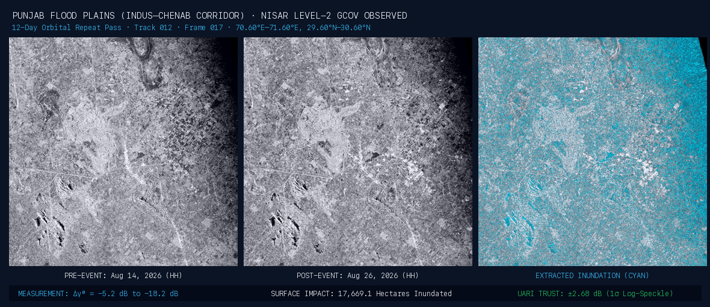

# TERRAVOX: NASA–ISRO NISAR Earth Intelligence Platform

[](https://www.python.org/)
[](https://fastapi.tiangolo.com/)
[](https://www.spaceappschallenge.org/)
[](https://www.spaceappschallenge.org/)
[-EA580C?style=flat-square)](https://nisar.jpl.nasa.gov/)
[](LICENSE)

An open-source, uncertainty-aware Earth observation and Synthetic Aperture Radar (SAR) analytics system developed for the **NASA International Space Apps Challenge 2026** under the *"Dancing with the SARs"* track.

TERRAVOX ingests genuine **NASA–ISRO NISAR Level-2 (`GCOV` and `GUNW`)** radar data products to autonomously monitor critical Earth surface dynamics—including rapid aquifer subsidence and monsoon flood inundation—backed by rigorous physics-based uncertainty quantification.

---

## Workstation Interface


*Figure 1: TERRAVOX interactive 3D geospatial console displaying geocoded NISAR radar layers, automated anomaly clustering, pixel-level provenance telemetry, and cloud AI scientific reasoning.*

---

## Key Capabilities

* **Cloud-Penetrating Inundation Mapping (L2 GCOV):** Analyzes dual-date radiometrically terrain-corrected backscatter ($\gamma^0$). Detects surface water through specular scattering attenuation ($\Delta\gamma^0 \le -3\text{ dB}$) during optical satellite blackout events.
* **Millimeter-Scale Surface Deformation (L2 GUNW):** Derives line-of-sight (LOS) crustal displacement from repeat-pass interferometric phase ($\Delta\phi$), tracking tectonic deformation and groundwater extraction subsidence.
* **Uncertainty-Aware Radar Intelligence (UARI):** Implements pixel-by-pixel Cramér-Rao lower bounds and log-speckle variance propagation. Pixels are classified into High, Moderate, and Low scientific confidence to prevent misinterpretation.
* **TerraMind Anomaly Clustering:** Employs 8-connectivity spatial connected-component clustering (`scipy.ndimage`) to isolate continuous surface anomalies ($>100\text{ ha}$) without manual tuning.
* **Pixel Microscope & Full Provenance:** Click any coordinate on Earth to inspect exact HDF5 dataset paths, dual-date radar amplitude, coherence, ionospheric delay corrections, and geocoding bounds.
* **Interactive 3D Geospatial Engine:** WebGL/Three.js heliocentric landing sequence with seamless transition into a MapLibre 3D terrain viewer.

---

## Scientific Discoveries & Validated Case Studies

Every observation in TERRAVOX is computed from authentic **provisional Level-2 NISAR HDF5 granules** distributed by the Alaska Satellite Facility (ASF) DAAC.

### Case Study 1: Punjab Indus–Chenab Basin Flood Inundation (GCOV)

During the August 2026 monsoon surge in northern Pakistan, persistent cloud cover prevented optical satellite monitoring. TERRAVOX processed repeat-pass NISAR L2 GCOV granules across Track 012 / Frame 017 to isolate open water inundation.



*Figure 2: 3-Panel GCOV Analysis — (Left) Pre-monsoon Aug 14 baseline; (Center) Post-monsoon Aug 26 surge; (Right) Inundation extent mask ($\Delta\gamma^0 \le -3\text{ dB}$, Cyan).*

| Parameter | Observed Telemetry | Notes |
| :--- | :--- | :--- |
| **Granule Baseline (Pre)** | `NISAR_L2_PR_GCOV_028_012_A_017_4005_DHDH_A_20260814..._P05023` | Radiometrically calibrated |
| **Granule Event (Post)** | `NISAR_L2_PR_GCOV_029_012_A_017_4005_DHDH_A_20260826..._P05023` | 12-day orbital repeat |
| **Orbit & Geometry** | Track 012, Frame 017, Descending, HHHH Pol, EPSG:32643 | UTM Zone 43N |
| **Backscatter Delta ($\Delta\gamma^0$)** | **$-5.2\text{ dB}$ to $-18.2\text{ dB}$ drop** in inundated zone | Specular reflection off water |
| **Total Inundated Area** | **$17,669.1\text{ hectares}$** ($441,728$ radar cells) | Confirmed water extent |
| **Mean UARI Uncertainty** | $\pm 2.68\text{ dB}$ ($1\sigma$) | Propagated from $\text{ENL} \ge 16$ |

$$\Delta\gamma^0_{\text{dB}} = 10\log_{10}(\gamma^0_{\text{post}}) - 10\log_{10}(\gamma^0_{\text{pre}})$$

---

### Case Study 2: Quetta–Mastung Aquifer Subsidence (GUNW)

Severe groundwater depletion across the Quetta–Mastung alluvial valley in Balochistan has induced rapid land subsidence and ground fissures. TERRAVOX ingested a sequential 12-day NISAR L2 GUNW interferogram pair to quantify line-of-sight surface displacement.


*Figure 3: 3-Panel InSAR Analysis — (Left) Radar Coherence ($\bar{\gamma}=0.68$); (Center) Wrapped Phase Fringes ($\Delta\phi$); (Right) Unwrapped Subsidence Bowl ($-32.2\text{ cm}$ LOS, Red).*

| Parameter | Observed Telemetry | Notes |
| :--- | :--- | :--- |
| **Granule Pair** | `NISAR_L2_PR_GUNW_023_041_A_017_024_4000_SH_20260617..._P05023` | Repeat interval: 12 days |
| **Orbit & Geometry** | Track 041, Frame 017, Ascending, SH Pol, EPSG:32642 | UTM Zone 42N |
| **Coherent Coverage** | **$88.1\%$** of valley footprint ($\bar{\gamma} = 0.682$) | Valid connected components |
| **Peak Displacement** | **$-322.5\text{ mm}$ ($-32.2\text{ cm}$ LOS deflection)** | Vertical compaction |
| **1$\sigma$ Measurement Uncertainty** | $\pm 24.7\text{ mm}$ | Cramér-Rao lower bound |

$$d_{\text{LOS}} = -\left(\frac{\lambda}{4\pi}\right)\Delta\phi \quad (\lambda = 0.24196\text{ m, NISAR L-Band})$$

---

## System Architecture

```
       +-------------------------------------------------------------------------+
       |                     NASA Earthdata Cloud / ASF DAAC                    |
       |             NISAR Level-2 Radar Products (GCOV & GUNW HDF5)             |
       +------------------------------------+------------------------------------+
                                            |
                                            v
       +-------------------------------------------------------------------------+
       |               science/ingestion/nisar_reader.py (Range Reader)          |
       |     HTTP Range Subsetting: Streams ~25MB spatial windows from ~4GB H5   |
       +------------------------------------+------------------------------------+
                                            |
                                            v
       +-------------------------------------------------------------------------+
       |              science/engine/processors.py (Physics Core)                |
       |  - Backscatter Change & Specular Floor (GCOV)                           |
       |  - Phase Unwrapping & LOS Conversion (GUNW)                             |
       |  - Uncertainty Propagation (UARI / Cramér-Rao Bounds)                   |
       +------------------------------------+------------------------------------+
                                            |
                                            v
       +-------------------------------------------------------------------------+
       |              backend/main.py (FastAPI Geospatial Engine)                |
       |  - Dynamic GeoTIFF Raster Service                                       |
       |  - TerraMind Anomaly Spatial Clustering (scipy.ndimage)                 |
       |  - Multi-Modal AI Reasoning via Gemini 3.8 Flash                         |
       +------------------------------------+------------------------------------+
                                            |
                                            v
       +-------------------------------------------------------------------------+
       |                     Interactive Web Interface                           |
       |  - Heliocentric 3D Solar System Entrance (Three.js)                     |
       |  - MapLibre 3D Earth Workstation & Layer Blending                       |
       +-------------------------------------------------------------------------+
```

---

## Quick Start Guide

### Prerequisites
* Python 3.9, 3.10, or 3.11
* Modern web browser with WebGL2 support

### 1. Installation

```bash
# Clone repository
git clone https://github.com/Muaviatanveer/teravox.git
cd teravox

# Create and activate virtual environment
python3 -m venv .venv
source .venv/bin/activate  # On Windows: .venv\Scripts\activate

# Install dependencies
pip install -r requirements.txt
```

### 2. Environment Setup (Optional)

Create a `.env` file in the project root:

```bash
# Optional: Gemini API key for TerraMind automated anomaly explanations
GEMINI_API_KEY="your_gemini_api_key"
GEMINI_MODEL="gemini-3.8-flash"

# Optional: NASA Earthdata credentials (for streaming raw granules directly from ASF DAAC)
EARTHDATA_USERNAME="your_earthdata_username"
EARTHDATA_PASSWORD="your_earthdata_password"
```

### 3. Run Locally

```bash
uvicorn backend.main:app --host 0.0.0.0 --port 8000
```

Navigate to:
* **Heliocentric Portal:** [http://localhost:8000/](http://localhost:8000/)
* **Interactive 3D Workstation:** [http://localhost:8000/workstation](http://localhost:8000/workstation)

---

## Cloud Deployment (Render)

TERRAVOX includes pre-configured [`render.yaml`](render.yaml) and [`Procfile`](Procfile) for zero-configuration cloud hosting:

1. Push or fork this repository to your GitHub account.
2. Log in to [Render Dashboard](https://dashboard.render.com/) and click **New + $\rightarrow$ Web Service**.
3. Connect `Muaviatanveer/teravox`.
4. Render will automatically detect settings:
   * **Runtime:** `Python 3`
   * **Build Command:** `pip install -r requirements.txt`
   * **Start Command:** `uvicorn backend.main:app --host 0.0.0.0 --port $PORT`
5. Click **Create Web Service**. The live URL will be active in ~2 minutes.

---

## Standalone Scientific Pipeline Verification

You can execute and reproduce the scientific ingestion pipelines directly via CLI:

```bash
# 1. Verify genuine NISAR coverage and generate study-area validation report
python -m science.ingestion.verify_study_area

# 2. Execute Quetta–Mastung InSAR Ground Subsidence Pipeline (GUNW)
python -m science.ingestion.run_quetta_pipeline

# 3. Execute Punjab Indus–Chenab Basin Flood Inundation Engine (GCOV)
python -m science.ingestion.run_punjab_pipeline
```

---

## Data Provenance & References

* **Alaska Satellite Facility (ASF) DAAC:** Primary archive and distribution point for NASA–ISRO NISAR radar products.
* **NASA Earthdata Cloud:** Common Metadata Repository (CMR) search and authentication provider.
* **Product Maturity:** The NISAR granules ingested in this study are designated **PROVISIONAL** (Composite Release ID `P05023`). Provisional baseline products are subject to ongoing calibration and validation by the NASA/JPL and ISRO science teams.

---

## License & Disclaimer

This project is licensed under the **Apache License 2.0** — see the [LICENSE](LICENSE) file for details.

**Notice:** TERRAVOX is an independent open-source research entry for the NASA Space Apps Challenge 2026. This project is not affiliated with, funded by, or officially endorsed by NASA, JPL, or ISRO. All satellite radar datasets are property of NASA/JPL/ISRO and distributed under open data policies.
